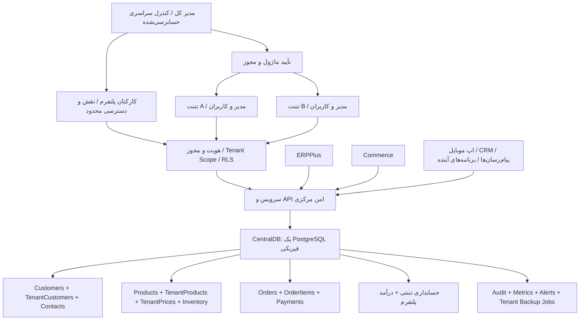

# معماری مفهومی — نمودار قابل نسخه‌بندی

این چارت صرفاً conceptual است و جایگزین ERD واقعی مبتنی بر schema موجود نمی‌شود.

نکته: فلش‌های نمایشی به معنی اتصال آزاد مستقیم کاربران/برنامه‌ها به DB نیستند. همه عملیات به سرویس مرکزی و احراز هویت محدود است. نسخه اولیه داده‌های فعلی: ERPPlus/MySQL و Commerce/PostgreSQL؛ انتقال فقط پس از بررسی و تأیید.
