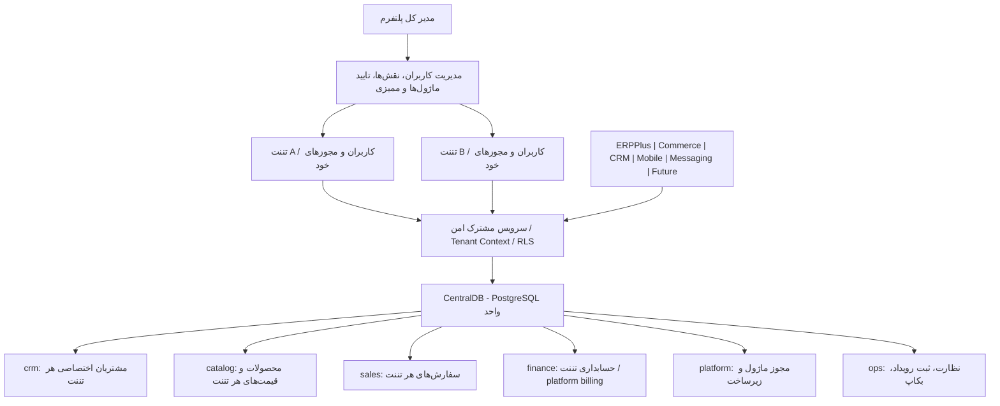
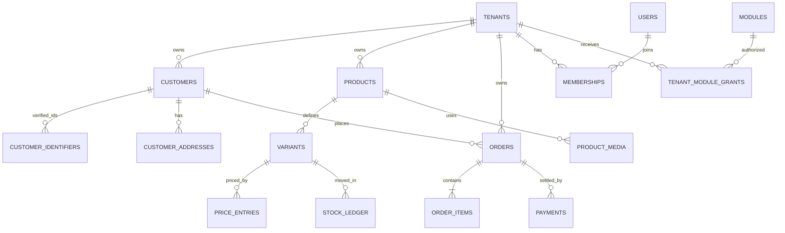

> **D-013:** این ERD مبنای نمونه اجرایی مستقل است؛ جزئیات باز هنوز مصوب نهایی نیستند. وضعیت NO DDL مربوط به زمان تدوین V0 است؛ وضعیت کد و آزمون در PROJECT_STATE.

# TARGET_ERD_V0_FA — طرح اولیه مستقل دیتابیس جدید
وضعیت: **PROPOSED / NOT APPROVED / NO DDL** | تاریخ: 2026-11-24
**اولویت:** نیازهای اعلامی مالک > قواعد یکپارچگی و امنیت > ساختار دیتابیس قدیمی. نام‌ها، کلیدها و روابط پیشنهادی‌اند؛ هیچ جدول واقعی ساخته نشده است.

## طراحی کلان: یک PostgreSQL فیزیکی

## جدول‌های پیشنهادی و علت وجود هرکدام
| حوزه | مرجع پیشنهادی | کلید/دامنه اصلی | توجیه، عدم تکرار |
|---|---|---|---|
| تننت | `core.tenants` | tenant_id PK | هر سازمان یک شناسه مرکزی |
| حساب کاربری | `core.users` | user_id PK | حساب ورود مرکزی، مستقل از تننت |
| عضویت | `iam.memberships` | (tenant_id,user_id) unique | یک کاربر در چند تننت با نقش مستقل |
| نقش/مجوز | `iam.roles`, `iam.permissions`, `iam.role_grants`, `iam.membership_roles` | tenant scope + role grants | مجوزها داده‌اند نه کدهای پراکنده؛ نیازمند الگوی inherited permission |
| کارمند پلتفرم | `iam.platform_staff_assignments` | user_id + scoped permission | از اعضای تننت تفکیک، بدون جدول کاربران دوم |
| ماژول | `platform.modules`, `platform.tenant_module_grants`, `platform.approval_requests` | tenant_id/module_id | فعال‌سازی فقط با تایید مدیر کل، ثبت تاریخچه |
| مشتری | **`crm.customers`** | customer_id PK + tenant_id | **یک مرجع مشتری در هر تننت**؛ برای هر Store یا App یک Customers جدید نساز |
| هویت/کانال مشتری | `crm.customer_identifiers` | tenant_id + (kind,normalized_value) با یکتایی هویت تاییدشده | تلفن/ایمیل/شناسه کانال‌ها به همان customer_id متصل؛ جلوگیری از ادغام اشتباه |
| آدرس/ارتباط | `crm.customer_addresses`, `crm.interactions` | (tenant_id,customer_id) FK | داده مستقل 1:N، نه مشتری موازی |
| محصول | **`catalog.products`** | product_id PK + tenant_id | **یک مرجع محصول متعلق به تننت**؛ global catalog الزامی/پیش‌فرض نیست |
| تنوع/دسته/عکس | `catalog.variants`, `catalog.categories`, `catalog.product_categories`, `catalog.product_media` | tenant+product FK | فرزند مستقل/رابطه چندبه‌چند یا metadata فایل، نه product mirror |
| قیمت | `catalog.price_entries` | tenant_id, variant_id, price_list/currency/effective period | فقط یک مرجع قیمت معتبر برای محدوده تعیین‌شده؛ عدم هم‌پوشانی تاریخ اعتبار |
| انبار و موجودی | `inventory.warehouses`, `inventory.stock_ledger`, `inventory.reservations` | tenant_id + variant_id + warehouse_id | ledger منبع معتبر؛ balance تجمیعی **مشتق/کش** نه موجودی مستقل قابل ویرایش |
| سفارش | **`sales.orders`** | order_id PK + tenant_id + customer_id | یک سفارش مرجع میان تمام کانال‌ها، external idempotency |
| قلم/پرداخت/استرداد | `sales.order_items`, `sales.payments`, `sales.refunds` | tenant_id + order_id | snapshot قیمت در لحظه سفارش تاریخچه قانونی است نه دیتای تکراری موازی |
| حسابداری تننت | `finance.accounts`, `finance.journal_entries`, `finance.journal_lines` | tenant_id + financial period | دفاتر هر تننت مستقل |
| درآمد پلتفرم | `platform.subscriptions`, `platform.subscription_invoices`, `platform.billing_payments` | platform billing scope | صورت‌حساب حق اشتراک با فروش تننت قاطی نشود |
| محتوا | `content.articles`, `content.assets` | tenant_id | مطالب هر تننت و فایل‌های مرتبط |
| نظارت | `ops.audit_events`, `ops.incidents`, `ops.health_snapshots` | tenant_id nullable + actor | بررسی سراسری مدیر کل و رخداد مختص تننت |
| رویداد تغییر | `ops.outbox_events` | event_id PK, tenant scope | اعلان تغییر از تراکنش مشترک، بدون Sync بین DB |
| بکاپ تننتی | `ops.tenant_backup_snapshots`, `ops.restore_jobs` | tenant_id + timestamp | metadata پشتیبان/بازیابی؛ فایل‌های بکاپ در storage امن خارج از repo |

**نکته کلیدی:** دو جدول `Customers` و `TenantCustomers` به‌طور خودکار ایجاد نمی‌شوند؛ چون مشتری‌ها از ابتدا tenant-owned هستند، جدول مشتری `tenant_id` دارد. اگر نیاز واقعی رابطه N:N متفاوت پیدا شد، فقط با توجیه و تایید مالک طراحی مجدد می‌کنیم. همین اصل برای Products/TenantProducts است.

## روابط اصلی پیشنهادی

**هشدار:** FKهای tenant-aware باید به‌گونه‌ای ساخته شوند که اتصال cross-tenant از مسیر شناسه مشتری/محصول ممکن نباشد، از جمله composite FK و RLS. این diagram فقط موجودیت‌های هسته‌ای را نشان می‌دهد، نه تمام جزئیات فیزیکی.

## سناریوهای پذیرش که باید قبل از مهاجرت پاس شوند
1. شماره مشتری در واتساپ تننت A ثبت و سپس سفارش با همان هویت تاییدشده در سایت تننت A ثبت می‌شود: **یک customer_id**، نام/آدرس کامل‌تر؛ نه Customer دیگر برای Store یا کانال دیگر.
2. همان فرد در تننت B خرید می‌کند: **customer_id مستقل برای B**؛ هیچ اطلاعات خصوصی تننت A برای B در دسترس نیست.
3. قیمت یا موجودی variant تننت A از ERPPlus عوض می‌شود: Commerce و اپ همان مرجع را می‌خوانند و cache/event به‌روز می‌شود؛ بدون mirror DB یا sync دستی.
4. کاهش موجودی سفارش و پرداخت idempotent باشد؛ هر بار ثبت سفارش فقط یک اثر روی ledger داشته باشد.
5. هر کارمند/کاربر فقط tenant و مجوز خود را ببیند؛ مدیر کل audit سراسری دارد؛ module بدون تایید فعال نشود.
6. بکاپ و restore آزمایشی tenant A هیچ تغییری در tenant B ایجاد نکند.
7. صفحات پنل مدیر کل خطا، مصرف، سفارش، مشتری، قیمت، امنیت و بکاپ تک‌تک تننت‌ها را با شاخص‌های قابل اندازه‌گیری نشان دهند.

## جدا نگه داشتن legacy از هدف
`docs/CURRENT_INVENTORY.md` و `docs/CURRENT_DATA_MAP.md` صرفاً **داده‌های ورودی تبدیل** را شرح می‌دهند. نباید مدل ERPPlus یا CommerceAI را کپی کرد. پس از تایید این مدل توسط مالک، `LEGACY_TO_TARGET_MAPPING.md` با نگاشت فیلد به فیلد، قواعد ادغام، ریسک مالی/شناسه/تاریخچه و تست سازگاری تهیه می‌شود. **خود دیتابیس زنده هنوز بررسی نشده و DDL/Migration اجرا نشده است.**

## الحاقیه 2026-11-24 — شناسنامه کامل تننت، شرکت/شرکا و تحلیل بازدید
نیازمندی‌ها و ساختار پیشنهادی در [TENANT_IDENTITY_VISITOR_ATTRIBUTION_FA.md](TENANT_IDENTITY_VISITOR_ATTRIBUTION_FA.md) ثبت شد. این فایل مبنای طراحی تکمیلی است، نه تأیید تعداد جدول یا اجرای Migration.
- `core.tenants` تنها مرجع سازمان/تننت باقی می‌ماند؛ شناسنامه حقوقی/حقیقی، شرکا و سهامداران، نمایندگان مجاز و آدرس‌های سازمان، اجزای وابسته‌اند نه Tenant یا Customer جایگزین.
- `core.users` تنها مرجع حساب ورود باقی می‌ماند؛ کاربر تننت اطلاعات کارمندی، ترجیحات، عضویت و مجوز اختصاصی از طریق `iam.memberships` و جداول وابسته می‌گیرد.
- جمع‌آوری `web.visitor_sessions` و `web.visit_events` فقط با حق استفاده معتبر و تأیید ماژول Commerce؛ بازدیدکننده ناشناس هرگز به‌صورت خودکار مشتری محسوب نمی‌شود.
- منبع جذب در `crm.customer_acquisition_events` به همان `crm.customers` تننت متصل می‌شود؛ منبع اولین ورود و انتساب هر سفارش را جداگانه محاسبه کن؛ از Customer/Users/Product دوباره‌سازی‌شده پرهیز کن.
- ساختار گزارش‌گیری هر تننت باید تحلیل منابع ورود، کمپین، بازدید، مشتری تبدیل‌شده و سفارش را همراه با جداسازی tenant و کنترل داده شخصی پوشش دهد.

## الحاقیه REQ-016 — اپ و Multi-price؛ بدون تکرار مرجع
- کاتالوگ جدید **همین حالا** price_lists و price_entries دارد؛ چند قیمت همزمان برای یک variant در فهرست‌های مختلف پشتیبانی می‌شود. Price resolver/group/quantity tier و قیمت نهایی با مالیات/کوپن هنوز ناقص است. پیشنهاد: price-list assignment/rules و tiers وابسته، نه master price تکراری.
- به جای `web.visitor_sessions` و `mobile.app_sessions` مستقل، **یک `analytics.sessions` و `analytics.events`** با tenant/channel/application/site و consent/referrer/attribution، و منابع مستقل «دانلود رسمی تجمیعی مارکت» و «نصب/اولین اجرا» ایجاد شوند. هنوز فقط طرح است.
- مرجع‌های موجود `crm.customers`, `core.users`, `sales.orders`, `catalog.products` و `platform.modules` دست نخورده/یکتا بمانند؛ ردیابی اپ مجوز تننتی و داده واقعی خصوصی لازم دارد.
- مشخصات کامل، حد مرز حریم خصوصی، آزمون‌ها و ترتیب اجرا: [APP_ANALYTICS_MULTI_PRICE_FA.md](APP_ANALYTICS_MULTI_PRICE_FA.md).

## الحاقیه قیمت D-017 — چهار حالت اصلی
لیست‌های تجاری `original`, `discounted`, `colleague`, `wholesale` از **همان** `catalog.price_lists` استفاده می‌کنند و مبالغ با اعتبار زمانی در `catalog.price_entries` نگهداری می‌شوند. در `0014` برای قواعد مقدار خرید `price_quantity_tiers` نوشته شده ولی CI آن تأیید نشده است. هیچ چهارستون قیمتِ تکراری به `catalog.products` اضافه نکن. محدودیت تخفیف، تشخیص مشتری همکار و عمده، و حفاظت از قیمت خصوصی هنوز نیازمند کد اجرایی و تست هستند. مرجع: [FOUR_PRODUCT_PRICE_TYPES_FA.md](FOUR_PRODUCT_PRICE_TYPES_FA.md).
